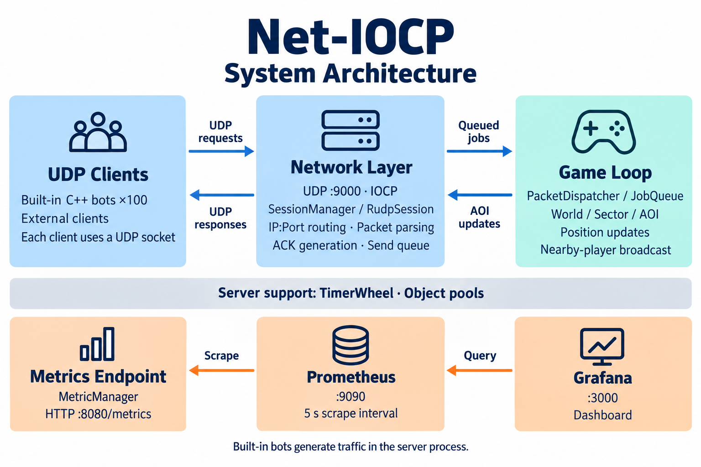

# Net-IOCP

**Windows IOCP 기반의 C++ UDP 게임 서버 프로젝트**

비동기 네트워크 I/O부터 세션 관리, 위치 동기화, 관심 영역(AOI) 브로드캐스트, 모니터링까지 직접 구현한 서버입니다. 내장 C++ 봇이 실제 UDP 소켓으로 이동 패킷을 보내고, 서버의 처리 상태를 Prometheus와 Grafana로 확인할 수 있습니다.


[실행 방법](#실행-방법) · [시스템 아키텍처](#시스템-아키텍처) · [모니터링](#모니터링) · [설계 문서](#설계-문서)

## 프로젝트 소개

실시간 게임 서버에서 **네트워크 수신과 게임 상태 갱신을 어떻게 분리할 것인가**, **어떤 클라이언트에게 상태를 전달할 것인가**를 다룹니다.

- **비동기 I/O**: 공유 UDP 소켓에 여러 수신 컨텍스트를 등록하고, IOCP 작업 스레드에서 완료 이벤트를 처리합니다.
- **주소 기반 세션 관리**: 클라이언트의 `IP:Port`로 세션을 구분하여 패킷을 라우팅합니다.
- **게임 로직 분리**: 패킷 핸들러를 작업 큐에 넣고 메인 루프에서 실행합니다.
- **공간 기반 동기화**: 월드를 격자로 나누고 인접 섹터와 거리 조건으로 위치 정보를 받을 플레이어를 선택합니다.
- **실행 상태 관찰**: 봇의 트래픽과 세션·패킷·재전송 카운터를 대시보드에서 확인합니다.

기본 브랜치는 **`develop`**이며, 초기 기획·분석·설계 자료는 **[`docs`](https://github.com/GeonRyoung/Net-IOCP/tree/docs/Plan)** 브랜치에 보관되어 있습니다.

## 시스템 아키텍처

<p align="center">
  
</p>

### 위치 패킷 처리 흐름

1. `WSARecvFrom` 수신 작업이 완료되면 IOCP 작업 스레드가 이벤트를 받습니다.
2. `SessionManager`가 송신 주소에 대응하는 `RudpSession`을 찾거나 생성합니다.
3. 세션이 패킷을 파싱하고, 시퀀스가 있는 일반 패킷에 ACK를 보냅니다.
4. `PacketDispatcher`가 위치 갱신 작업을 `JobQueue`로 전달합니다.
5. 메인 루프가 플레이어 위치와 섹터를 갱신하고 AOI 안의 다른 플레이어에게 위치 패킷을 보냅니다.

## 핵심 구현

| 영역 | 구현 내용 | 코드 |
|---|---|---|
| IOCP | 완료 포트, 작업 스레드 풀, 수신·송신 이벤트 분기 | [IocpCore.cpp](Net-Iocp/Core/IocpCore.cpp) |
| 세션 관리 | 공유 UDP 소켓과 `IP:Port` 기반 세션 조회·생성 | [SessionManager.h](Net-Iocp/Core/SessionManager.h) |
| RUDP 구성 요소 | 시퀀스·ACK 비트맵, 미확인 패킷 관리, 재전송·백오프 코드 | [RudpSession.cpp](Net-Iocp/Core/RudpSession.cpp) |
| 실행 분리 | I/O 스레드의 패킷 작업을 메인 루프에서 실행 | [PacketDispatcher.cpp](Net-Iocp/Core/PacketDispatcher.cpp), [GameLogic.cpp](Net-Iocp/Core/GameLogic.cpp) |
| 공간 분할 | 격자 섹터 이동과 거리 기반 AOI 브로드캐스트 | [World.cpp](Net-Iocp/Core/World.cpp) |
| 객체 재사용 | 태그 포인터와 CAS 기반 free list, `shared_ptr` 반환 시 풀 회수 | [LockFreeObjectPool.h](Net-Iocp/Core/LockFreeObjectPool.h) |
| 타이머 | 슬롯에 콜백을 저장하고 틱마다 작업 큐로 전달 | [TimerWheel.cpp](Net-Iocp/Core/TimerWheel.cpp) |
| 더미 클라이언트 | 독립 UDP 소켓을 사용하는 봇과 상태 머신 | [Bot.cpp](Net-Iocp/Core/Bot.cpp), [BotManager.cpp](Net-Iocp/Core/BotManager.cpp) |

### 기본 실행 설정

아래 값은 현재 [서버 진입점](Net-Iocp/Net_Iocp.cpp)에 설정되어 있습니다.

| 항목 | 기본값 |
|---|---|
| 게임 서버 / 메트릭 | UDP `9000` / HTTP `8080/metrics` |
| IOCP 작업 스레드 | 시스템 프로세서 수 × 2 |
| 미리 등록하는 수신 컨텍스트 | 100개 |
| 내장 봇 | 100개, `127.0.0.1:9000`으로 전송 |
| 메인 루프 목표 간격 | 16ms |
| 월드 / 섹터 크기 | `1000 × 1000` / `100 × 100` |
| 위치 브로드캐스트 반경 | 월드 좌표 기준 50 |

## 패킷 구조

모든 패킷은 **8바이트 헤더 + 본문**으로 구성되며 최대 크기는 512바이트입니다. 구조체는 1바이트 정렬을 사용하고, 현재 Windows 클라이언트·서버는 little-endian 바이트 순서로 주고받습니다.

| 헤더 필드 | 자료형 | 크기 | 의미 |
|---|---|---|---|
| `size` | `uint16_t` | 2바이트 | 헤더를 포함한 전체 패킷 길이 |
| `opcode` | `uint16_t` | 2바이트 | 패킷 종류 |
| `sequence` | `uint32_t` | 4바이트 | 시퀀스 번호 |

| 패킷 | Opcode | 본문 |
|---|---|---|
| `CS_POSITION_UPDATE` | `0x0101` | `x`, `y` — 각 `float` |
| `SC_POSITION_UPDATE` | `0x0102` | `sessionId` — `uint64_t`, `x`, `y` — 각 `float` |
| `RUDP_ACK` | `0x0F01` | `ackNumber`, `ackBitmap` — 각 `uint32_t` |

전체 선언은 [Packet.h](Net-Iocp/Core/Packet.h)에 있습니다. 접속·인증·전투·스폰 등의 Opcode도 정의되어 있지만, 현재 진입점에서 등록하는 게임 핸들러는 **위치 갱신**입니다.

## 실행 방법

### 1. 준비 환경

- Windows 10 이상
- Visual Studio 2022: **C++를 사용한 데스크톱 개발**, MSVC v143, Windows SDK
- Docker Desktop: Prometheus·Grafana를 사용할 경우
- Python과 `rich`, `prompt_toolkit`: 외부 더미 CLI를 사용할 경우

### 2. 클론 및 빌드

```powershell
git clone --branch develop https://github.com/GeonRyoung/Net-IOCP.git
cd Net-IOCP
```

Visual Studio에서 `Net-Iocp.sln`을 열고 **Release / x64**를 선택합니다. 프로젝트 속성에서 C++ 언어 표준을 **C++17**, 전처리기 정의에 **`NOMINMAX`**, 추가 컴파일 옵션에 **`/utf-8`**을 설정한 뒤 빌드합니다.

명령줄에서는 **Developer PowerShell for VS 2022**에서 다음과 같이 실행할 수 있습니다. `CL` 옵션은 이 PowerShell 세션의 빌드에 적용됩니다.

```powershell
$env:CL = '/std:c++17 /utf-8 /DNOMINMAX'
msbuild .\Net-Iocp.sln /m /p:Configuration=Release /p:Platform=x64
.\x64\Release\Net-Iocp.exe
```

현재 프로젝트 파일에는 위 컴파일 옵션이 명시되어 있지 않습니다. 이 옵션으로 **Release x64 빌드 성공을 확인했습니다**.

### 3. 서버와 내장 봇 확인

서버는 UDP `9000`에서 수신을 시작하고 내장 봇 100개를 생성합니다. 봇은 약 3초의 대기 상태를 거쳐 이동 패킷을 전송하며, 이후 대기·이동·공격 상태를 순환합니다. 현재 네트워크로 전송하는 동작은 위치 갱신입니다.

다른 PowerShell 창에서 메트릭 응답을 확인합니다.

```powershell
(Invoke-WebRequest -UseBasicParsing http://localhost:8080/metrics).Content
```

콘솔에는 약 10초 간격으로 세션 수와 풀의 가용 객체 수가 출력됩니다. 내장 봇은 트래픽 발생 예제이며, 100이라는 값은 성능 한계나 검증된 동시 접속자 수를 뜻하지 않습니다.

## 모니터링

### 수집 주소 설정

[prometheus.yml](Net-Iocp/Monitoring/prometheus.yml)의 수집 대상은 현재 개발 환경의 고정 IP(`192.168.219.100:8080`)입니다. **같은 Windows PC에서 Docker Desktop과 서버를 실행한다면**, 해당 파일의 `targets`를 다음과 같이 변경합니다. 별도 PC의 서버를 모니터링한다면 그 PC의 주소를 사용합니다.

```yaml
global:
  scrape_interval: 5s

scrape_configs:
  - job_name: 'net-iocp'
    static_configs:
      - targets: ['host.docker.internal:8080']
```

### 대시보드 실행

저장소 루트에서 실행합니다.

```powershell
docker compose -f .\Net-Iocp\Monitoring\docker-compose.yml up -d
```

| 서비스 | 주소 | 확인할 내용 |
|---|---|---|
| 서버 메트릭 | http://localhost:8080/metrics | Prometheus 텍스트 형식의 지표 |
| Prometheus | http://localhost:9090/targets | `net-iocp` 대상의 `UP` 상태 |
| Grafana | http://localhost:3000 | 기본 로그인 `admin / admin` |

데이터 소스와 **Element-Pulse System Dashboard (Net-Iocp)** 대시보드는 자동 등록됩니다. 대시보드는 Global Metrics, Network Performance, System Resource로 구성되어 있습니다.

| 지표 | 의미 |
|---|---|
| `netiocp_uptime_seconds` | 프로세스 가동 시간 |
| `netiocp_active_sessions` | 세션 관리자에 등록된 세션 수 |
| `netiocp_packet_count` | 파싱 후 기록한 누적 수신 패킷 수 |
| `netiocp_retransmit_count` | 재전송 코드가 실행된 누적 횟수 |
| `netiocp_pool_available` | 세션 풀에서 재사용 가능한 객체 수 |
| `netiocp_latency_ms` | 현재는 데모용 임의 값 |
| `netiocp_worker_cpu_usage` | 현재는 데모용 임의 값 |

PPS 패널은 `rate(netiocp_packet_count[1m])`을 사용합니다. **CPU·지연시간은 실측 성능으로 해석하지 않으며**, 풀 가용 객체 수도 전체 메모리 사용량을 나타내지는 않습니다.

종료할 때는 서버 콘솔에서 `Ctrl+C`를 누르고 모니터링 컨테이너를 내립니다.

```powershell
docker compose -f .\Net-Iocp\Monitoring\docker-compose.yml down
```

## 외부 더미 CLI

Python 더미는 봇 수, 전송 생략 비율, 패킷 종류를 대화형 명령으로 조절하는 보조 도구입니다.

```powershell
python -m pip install rich prompt_toolkit
python .\Net-Iocp\dummy_client.py
```

| 명령 | 동작 |
|---|---|
| `start_bots 100` | UDP 더미 클라이언트 100개 추가 |
| `set_packet_loss 10` | 클라이언트가 전송할 패킷의 약 10%를 의도적으로 생략 |
| `run_scenario move` | 위치 Opcode 전송 |
| `run_scenario attack` | 전투 Opcode 전송 |
| `status` | 클라이언트 측 전송·생략 카운터 확인 |
| `exit` | 더미 종료 |

현재 Python 더미는 **8바이트 헤더만 전송**합니다. 위치 본문(`x`, `y`)과 서버 응답 수신·ACK 처리가 없어, 위치 동기화나 RUDP 신뢰성을 검증하는 클라이언트로 사용할 수는 없습니다. 위치 본문을 보내는 예제는 내장 C++ 봇을 참고하세요.

## 현재 구현 범위

현재 데모의 중심은 **UDP 수신 → 세션 라우팅 → 위치 갱신 → AOI 송신 → 메트릭 수집**입니다.

- **RUDP 연동**: ACK 생성, `ProcessAck`, 재전송·RTO 계산 코드는 있으나, 수신 ACK를 `ProcessAck`에 연결하는 핸들러는 아직 등록되어 있지 않습니다. 내장 봇도 응답 수신·ACK 전송을 구현하지 않아 양방향 신뢰성 검증은 후속 작업입니다.
- **게임 프로토콜**: 접속·인증·전투 등은 패킷 정의가 준비되어 있으며 실제 처리 흐름은 추가 구현이 필요합니다.
- **성능 측정**: CPU·지연시간 실측과 손실·재정렬 환경에서의 벤치마크는 별도로 수행해야 합니다.

## 저장소 구조

```text
Net-IOCP/
├── Net-Iocp.sln                 # Visual Studio 솔루션
├── Net-Iocp/
│   ├── Net_Iocp.cpp             # 초기화, 위치 핸들러, 봇, 메인 루프
│   ├── Net-Iocp.vcxproj         # MSVC v143 프로젝트
│   ├── Core/
│   │   ├── IocpCore.*          # IOCP 작업 스레드
│   │   ├── SessionManager.h    # 주소 기반 세션 관리
│   │   ├── RudpSession.*       # 세션 송수신·RUDP 구성 요소
│   │   ├── Packet.h            # 패킷 구조 및 Opcode
│   │   ├── PacketDispatcher.*  # 패킷 핸들러 라우팅
│   │   ├── GameLogic.*         # 작업 큐 실행
│   │   ├── World.* / Sector.*  # 월드·공간 분할
│   │   ├── Entity.h / Player.* # 엔티티·플레이어
│   │   ├── Bot*                # 내장 UDP 더미와 상태 머신
│   │   ├── TimerWheel.*        # 타이머 콜백 관리
│   │   ├── LockFreeObjectPool.h
│   │   └── MetricManager.h     # 메트릭 집계·직렬화
│   ├── Monitoring/             # Compose, Prometheus, Grafana
│   └── dummy_client.py         # 외부 더미 CLI
└── README.md
```

## 설계 문서

초기 요구사항과 설계 과정은 `docs` 브랜치에서 확인할 수 있습니다. 문서의 목표와 현재 `develop` 구현 범위는 구분해서 읽어 주세요.

- [프로젝트 기획](https://github.com/GeonRyoung/Net-IOCP/blob/docs/Plan/Conceptualization_%5B22212061_%EB%B0%95%EA%B1%B4%EB%A0%B9%5D.md)
- [요구사항 분석](https://github.com/GeonRyoung/Net-IOCP/blob/docs/Plan/Analysis_%5B22212061_%EB%B0%95%EA%B1%B4%EB%A0%B9%5D.md)
- [시스템 설계](https://github.com/GeonRyoung/Net-IOCP/blob/docs/Plan/Design_%5B22212061_%EB%B0%95%EA%B1%B4%EB%A0%B9%5D.md)

개발: **박건령** · [@GeonRyoung](https://github.com/GeonRyoung)
